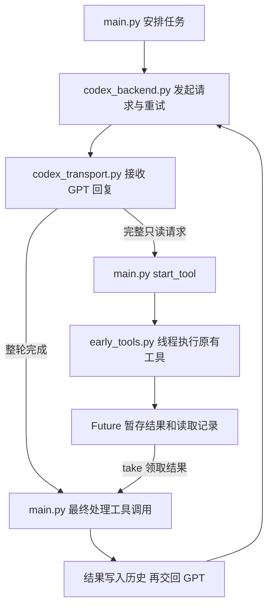

# 009：补充流式工具流程的人话注释

## 出处与目的

仍是原教程 docs/05-streaming.md:456“流式工具执行”，对应 Python agent.py:1500、:1633；实现与协议差异见 008。本次不进入新章节。用户表示代码难懂，要求把讲解直接写在代码旁边，因此补充标准中文 # 注释；可执行语句完全保持原样。

## 文件与阅读顺序

1. main.py：先看 run_agent 中 with EarlyTools，再看 start_tool、start_attempt、ask_model 的回调传递和最终 take。注释解释每层负责什么，以及“调用工具”日志不代表重新执行。
2. codex_backend.py：解释三个回调是本地函数，不发给 GPT；send_once 在每次尝试前清理任务，然后进行请求。官方 Chat 路径不提前触发。
3. codex_transport.py：解释文字片段、单个输出项完整和整轮响应完成是不同事件，完整调用通知 Agent 后继续接收。
4. early_tools.py：解释线程池和记录本、Future 如何领取结果、参数核对信息并非加密签名、独立读取状态的作用、重试/退出为何要取消或等待任务。

## 配合代码理解的执行流程

模型给出完整 read_file 请求 → 网络层调用 start_tool → early.start 检查名单/参数/编号 → 线程池执行 _execute → 主线程继续接收模型回复 → 整轮成功后 main 处理最终调用 → take 按编号及参数领取结果 → 合并读取时 mtime → 把工具结果放进 messages → 再问 GPT。

- tasks 保存“调用编号 → (核对信息, Future)”，不是直接保存文件内容。
- Future 是领取结果的任务对象；result() 在未完成时等待，完成时直接返回，不重新执行工具。
- 线程自己只写临时 read_state；主线程采用结果后才合并会话读取记录。
- discard 只用于尝试重置或管理器退出，清空剩余记录并取消排队任务、等待运行中的任务；不是写操作前的处理。不能强行停止已运行的 Python 线程。
- 重试重新建立任务，失败的只读访问可能已发生，但其结果和读取记录不被复用。
- 按原文逐个处理最终调用：有提前任务就采用；没有才走 execute_tool。写操作不清空其他提前任务。这里按顺序领取结果，不等于所有工具都按顺序开始执行。

## 架构图

## 验证与结果

四个 Python 文件修改前后使用 ast.parse/ast.dump 比较语法树：完全相同，证明确实只补注释，函数与执行语句没有改动。没有改工具参数、请求协议、并发行为或异常处理；继续使用 008 已验证的实现。git diff --check 通过；注释修改不需要重复请求模型或扩大测试。

## 限制和未完成内容

本次没有读取凭据或调用真实模型，没有提交推送。原文异步任务与本项目同步线程的区别，以及尚未接入第六章权限系统的限制，仍以 008 为准。下一节并行工具执行尚未开始。

2026-10-15：根据原文纠正了此前多加的写前清空与停止调度逻辑，注释已同步调整，详见 [010](010-2026-10-15-05-align-early-tools.md)。
